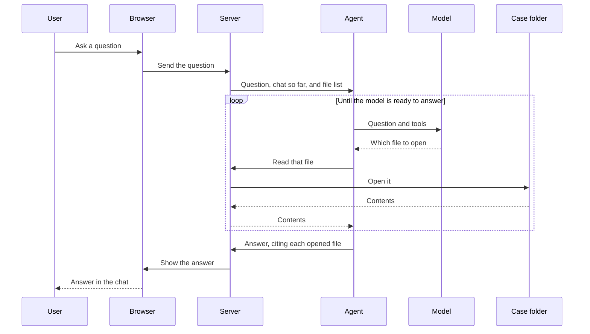

# MedDataOS

A local page for asking questions about one patient's files. Point it at a folder, start an agent, and the answer shows up in the chat.

The server uses [med-datactrl](../med-datactrl) to list and read the files in that folder. The agent is a separate program. The example agent lets an OpenAI-compatible model decide which files to open.

## Start

Copy `.env.example` to `.env` and set `OPENAI_MODEL`. `OPENAI_BASE_URL` and `OPENAI_API_KEY` tell the example agent where the model is.

In one terminal:

```bash
pixi run serve /path/to/folder
```

In another:

```bash
pixi run agent
```

Open the URL the server prints. The page selects the case named in `?patient=`.

## What a question goes through



If no agent is connected, the server holds the question until one connects. If the model opens no files, it answers in plain text and the read loop is skipped. If the server rejects the answer, the page keeps waiting and the agent sends a corrected one.

`pixi run test` starts the server on a small folder and talks to it as the page and as an agent.
