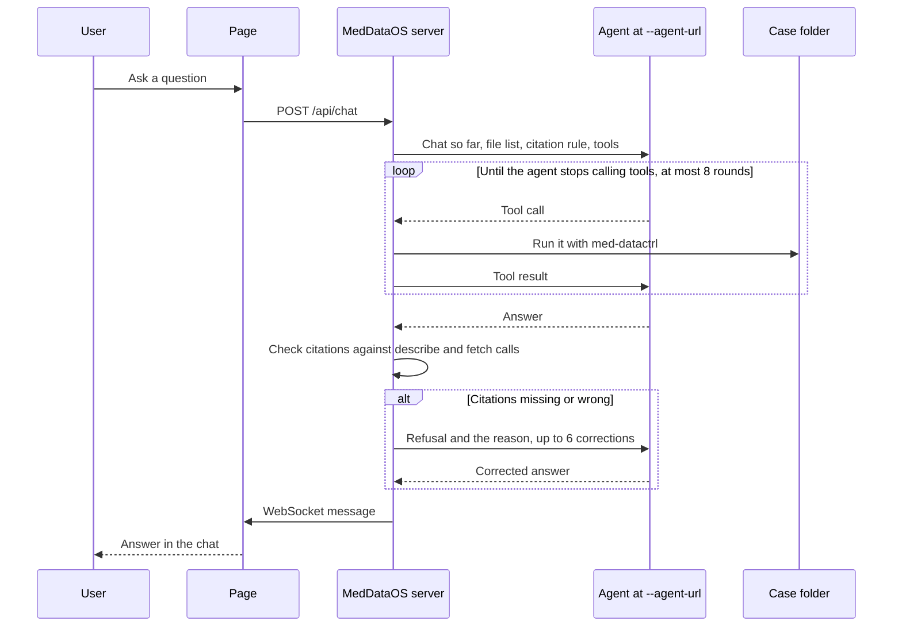

# MedDataOS

A local page for asking questions about the files in one folder. The server opens that folder with [med-datactrl](https://github.com/pmcdi/med-datactrl), serves the files, and sends each question to an OpenAI-compatible chat completions endpoint. That endpoint is the agent: the example in `examples/agent.py`, or any other program that speaks the same API.

One process opens one folder. Chat sessions, pins, and review checkboxes last until the process stops. Restart the server to open a different folder.

## Start

Copy `.env.example` to `.env`.

To use the example agent, set `OPENAI_MODEL`. Set `OPENAI_API_KEY` when the model requires one. `OPENAI_BASE_URL` is the model's base URL, the part before `/chat/completions`. The example agent calls `https://api.openai.com/v1` only when `OPENAI_BASE_URL` is unset. A blank value does not use that default, so set the URL or remove the line.

In one terminal:

```bash
pixi run agent
```

That serves `examples/agent.py` at `http://127.0.0.1:8001/v1` and prints the address to pass below. It forwards each request to `OPENAI_MODEL` and returns the model's message, including any tool calls.

In another terminal, pass the folder and that address:

```bash
pixi run serve /path/to/folder --agent-url http://127.0.0.1:8001/v1
```

The server refuses to start without `--agent-url`. Open the URL it prints. The query `?patient=` is the folder name, which is the only patient on the page.

To skip the example agent, point `--agent-url` at another chat completions endpoint, such as `http://127.0.0.1:11434/v1` for Ollama. The server sends `AGENT_MODEL` as `model`, `AGENT_API_KEY` as a bearer token when it is set, and waits `AGENT_TIMEOUT` seconds (default `120`). The example agent ignores `AGENT_MODEL` and uses `OPENAI_MODEL` instead.

`HOST` and `PORT` bind the page. The defaults are `127.0.0.1` and `8080`.

`pixi run test` starts the server on a small folder and talks to it as the page, as an agent, and as a model behind the example agent.

## What a question goes through



At startup the server also asks the agent to fill the patient card from the files. Until that reply arrives, and if it never does, the sidebar shows the folder name.

If the agent opens no files, it answers in plain text. If it still can't cite correctly after six corrections, or the agent can't be reached, the page shows that instead of waiting.

A successful `describe` or `fetch` of a file in the case list counts as opening it. The answer then has to be the citation JSON in [Connect an agent](docs/agents.md). With no file opened, plain text is accepted, and a JSON object is sent back with a request for plain text.

With no extra flags, the page talks only to `--agent-url`. Optional specialists are other chat endpoints, registered with `--agents` or repeated `--specialist name=url` flags. The server offers each one to the router as `consult_<name>`, runs that call, and still checks citations. [Connect an agent](docs/agents.md) describes both.

The example agent forwards to `OPENAI_MODEL`, or to Azure OpenAI when `AZURE_OPENAI_API_KEY`, `AZURE_OPENAI_ENDPOINT`, and `AZURE_OPENAI_DEPLOYMENT` are set.

If the citations are still wrong after the original answer and six corrections, the page shows `The agent could not produce an answer with valid citations` and the last problem. If the agent cannot be reached, times out, or returns something other than a chat completion, the page shows `The agent failed` and the reason.

The page renders a citation JSON answer as text with a marker for each `[cite:id]`. Hovering or opening a marker loads that file from the folder. [The page](web/README.md) covers the sidebar, pins, and attachments.
