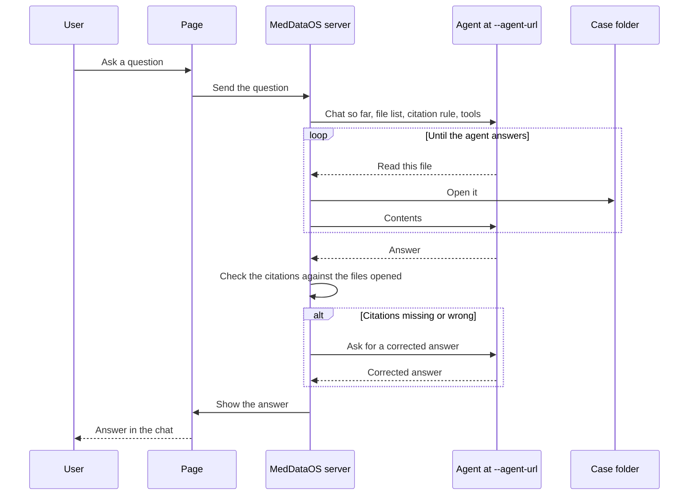

# MedDataOS

A local page for asking questions about one patient's files. Point it at a folder and an agent, and the answer shows up in the chat.

The server uses [med-datactrl](../med-datactrl) to list and read the files in that folder. The agent is a separate program: a model such as OpenAI or Ollama, or an agent you built and served behind the OpenAI chat completions API.

## Start

Copy `.env.example` to `.env`. Set `OPENAI_MODEL`, and `OPENAI_BASE_URL` plus `OPENAI_API_KEY` when the model is not OpenAI.

In one terminal:

```bash
pixi run agent
```

In another, pass the address the agent prints:

```bash
pixi run serve /path/to/folder --agent-url http://127.0.0.1:8001/v1
```

Open the URL the server prints. The page selects the case named in `?patient=`.

## What a question goes through



If the agent opens no files, it answers in plain text. If it still can't cite correctly after six corrections, or the agent can't be reached, the page shows that instead of waiting.

The page talks only to the agent at `--agent-url`. That agent is the router. Optional specialists, each an OpenAI-compatible endpoint, are registered with `--agents` or repeated `--specialist name=url` flags. The router calls them through `consult_<name>` tools; the server runs those calls, keeps specialists from calling each other, and still checks citations before the page shows the answer. [Connect an agent](docs/agents.md) describes both the single-agent call and the specialist registry.

`pixi run agent` serves `examples/agent.py` at `--agent-url` and forwards each question to `OPENAI_MODEL`, or to Azure OpenAI when `AZURE_OPENAI_API_KEY`, `AZURE_OPENAI_ENDPOINT`, and `AZURE_OPENAI_DEPLOYMENT` are set. Point `--agent-url` straight at another endpoint instead, such as `http://127.0.0.1:11434/v1` for Ollama. The clinical notes specialist is `python -m src.agents.notes.serve --case /path/to/case` in the MedDataOS repo; register it with `--specialist notes=http://127.0.0.1:8002/v1`.

`pixi run test` starts the server on a small folder and talks to it as the page, as an agent, and as a fake model.
